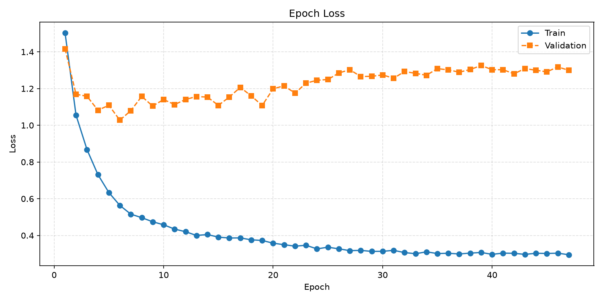
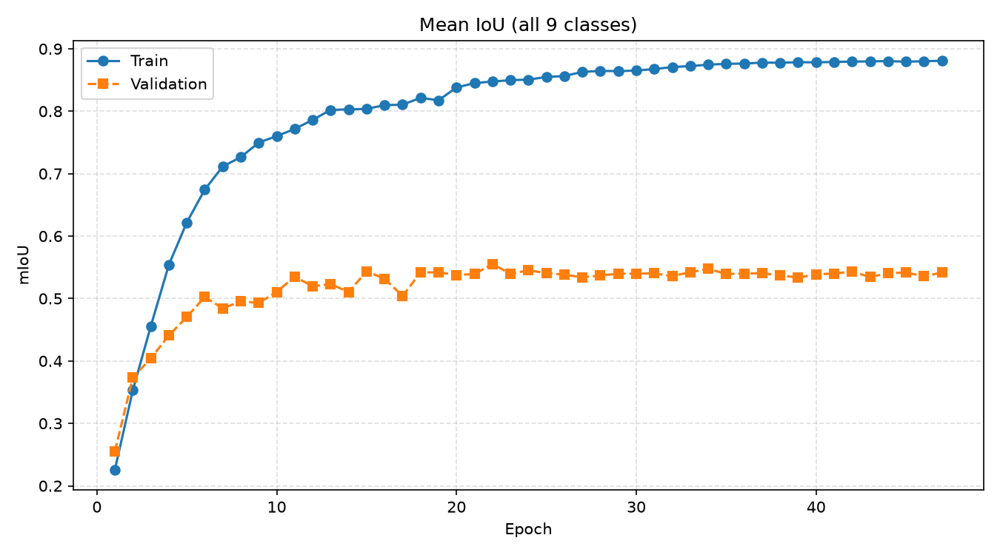
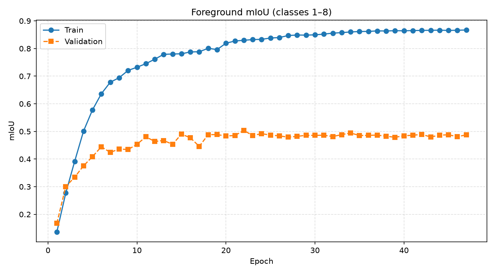
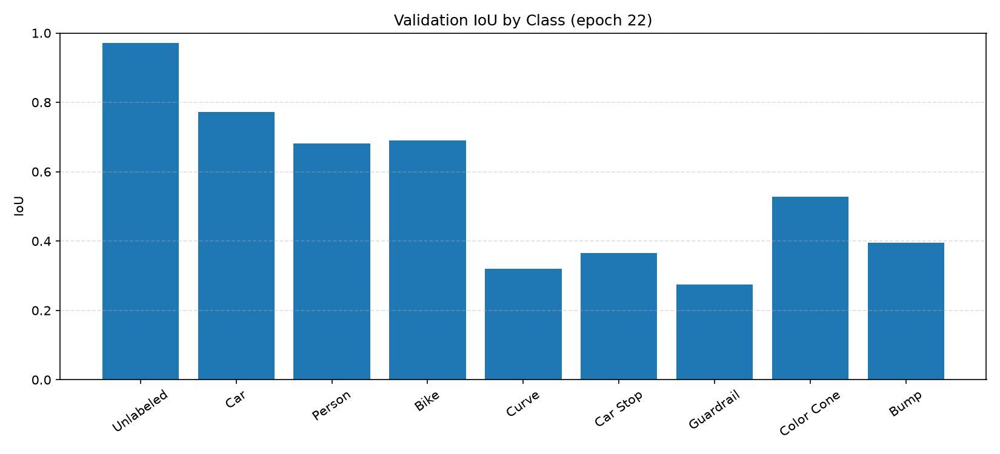
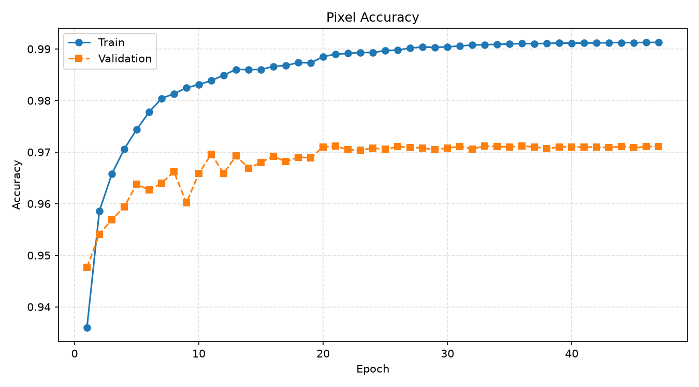
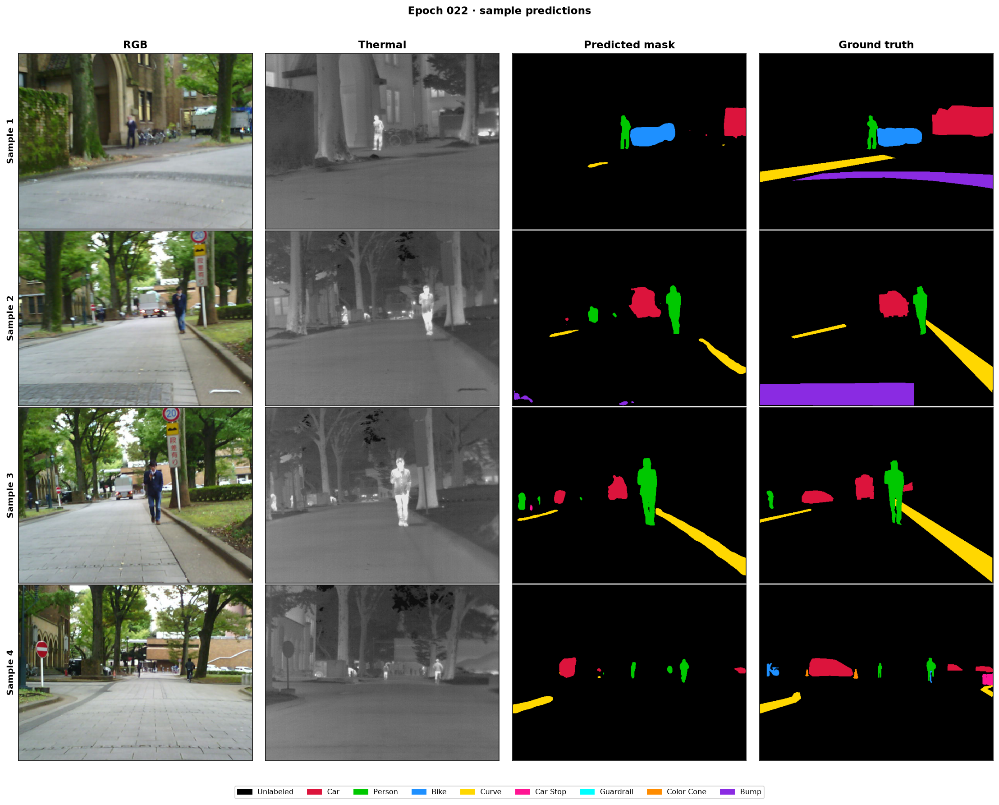

# RGB–Thermal Multi-Spectral Semantic Segmentation

A deep learning framework and interactive web application for multi-spectral urban scene semantic segmentation, combining visible **RGB** and **Thermal (Long-Wave Infrared / LWIR)** imagery using a **Pretrained Dual-Stream ResNet-18 Feature Pyramid with Multi-Scale Cross-Modal Attention Fusion (CMAF)**.

[](https://share.streamlit.io)
[](https://www.python.org/)
[](https://pytorch.org/)
[](https://www.kaggle.com/datasets/danialqashqai/mfnet-dataset)
[](#6-evaluation-metrics--experimental-results)
[](#3-model-architecture)

---

## 1. Project Overview

Semantic segmentation is a foundational task for autonomous vehicles, advanced driver assistance systems (ADAS), and mobile robotics. Standard RGB cameras capture rich color, texture, and fine-grained geometry under favorable illumination. However, optical vision degrades severely in real-world driving environments due to **total darkness, direct oncoming headlight glare, harsh shadow occlusions, dense fog, and inclement weather**.

Thermal (LWIR, $8–14\,\mu\text{m}$) cameras overcome these limitations by measuring radiating thermal energy rather than reflected visible light. Thermal imaging exposes high-contrast heat signatures for pedestrians, cyclists, and running vehicle engines even in pitch darkness or through blinding glare. However, thermal imagery lacks chromatic data and surface texture, making it difficult to delineate road markings, lane boundaries, and traffic signs.

This project delivers an end-to-end engineering solution that fusions both modalities:
1. **RGB Stream (3 channels):** Extracts fine texture, color distribution, and spatial contours.
2. **Thermal Stream (1 channel):** Provides temperature gradients and sharp object silhouettes unaffected by ambient light.
3. **Cross-Modal Attention Fusion (CMAF):** Dynamically gates and fuses features across 5 spatial scales via coupled channel- and spatial-attention gates.
4. **Interactive Streamlit Deployment:** A production-ready web application supporting paired image uploads, single MFNet RGBA PNGs, preloaded demo scenes, and real-time CPU/GPU inference.

---

## 2. Key Features

- **Pretrained Dual-Stream Encoders:** Parallel ResNet-18 backbones initialized with ImageNet weights. The thermal stream's initial convolution is adapted from 3 channels to 1 channel by averaging pretrained RGB kernels.
- **5-Scale Cross-Modal Attention Fusion (CMAF):** Operates at every level of the feature pyramid (stem, 1/4, 1/8, 1/16, 1/32 scales):
  - **Channel Gate:** Squeeze-and-excitation MLP modeling inter-modal dependencies.
  - **Spatial Gate:** Joint average- and max-pooling filters localizing salient spatial features.
  - **Residual Path:** Blends gated representations with a direct skip ($\text{Fused} + 0.5 \times [\text{RGB} + \text{Thermal}]$) preventing feature suppression during early training.
- **U-Net Decoder with Regularization:** 4-stage decoder with bilinear upsampling, $1\times1$ projections, feature concatenation, `ConvNormAct` blocks (GroupNorm + SiLU), and spatial dropout ($p=0.10$).
- **Differential Optimization:** AdamW optimizer utilizing $0.1\times$ learning rate ($3 \times 10^{-5}$) for pretrained encoders and $1.0\times$ ($3 \times 10^{-4}$) for fusion and decoder modules.
- **Hybrid Objective Function:** Class-weighted Cross-Entropy loss combined with multi-class Soft Dice loss, strictly ignoring boundary index 255.
- **Interactive Streamlit App:** Full interactive UI with opacity slider, customizable thermal colormaps, class breakdown analytics, and LFS-safe checkpoint retrieval.
- **Zero-Leakage Dataset Audit:** Includes `audit_mfnet.py` to verify split separation, check label integrity, and prevent data leakage.

---

## 3. Model Architecture

The model (`CustomDualStreamUNet` in `my_model.py`, `ARCHITECTURE_ID = "resnet18_dual_stream_cross_modal_attention_v2_1"`) processes synchronized 4-channel inputs:


### Module Parameter Breakdown

Total Trainable Parameters: **29,055,739 (29.06 Million)**

| Submodule | Specification / Mechanism | Parameters | Trainable |
|:---|:---|:---:|:---:|
| **RGB Encoder** | ResNet-18 (`torchvision.models.resnet18`, ImageNet weights) | 11,176,512 | Yes |
| **Thermal Encoder** | ResNet-18 (Conv1 adapted from 3 channels to 1 channel via mean kernel) | 11,170,240 | Yes |
| **CMAF (5 Scales)** | Channel Gate (SE MLP) + Spatial Gate ($7\times7$ Conv) + Residual Skip | 4,059,186 | Yes |
| **U-Net Decoder** | 4 Blocks: Bilinear Upsample + $1\times1$ Projection + Concat + $2\times$ ConvNormAct | 2,612,224 | Yes |
| **Segmentation Head** | ConvNormAct ($3\times3$, 64 ch) + Final $1\times1$ Conv ($64 \rightarrow 9$) | 37,577 | Yes |
| **Total Model** | **Dual-Stream ResNet-18 + CMAF + U-Net Decoder** | **29,055,739** | **100%** |

---

## 4. Dataset Description & Class Mapping

The model is trained on the benchmark **MFNet (Multi-Spectral Fusion Network)** urban driving dataset:

```
MFNet_dataset/
├── images/       # 4-channel PNG files (channels 0:3 RGB, channel 3 Thermal), 640x480
├── labels/       # Single-channel ground truth mask PNGs (pixel IDs 0-8, 255 ignored)
├── train.txt     # Training split manifest (1,568 samples / 784 unique scenes)
├── val.txt       # Validation split manifest (392 scenes)
└── test.txt      # Test split manifest
```

### Class Definitions & Verified MFNet Palette

| Class ID | Class Name | Description | RGB Color Code | Hex Swatch |
|:---:|:---|:---|:---:|:---:|
| `0` | **Unlabeled** | Background terrain, sky, unclassified pavement | `[0, 0, 0]` | `#000000` |
| `1` | **Car** | Passenger cars, SUVs, vans, buses, trucks | `[220, 20, 60]` | `#DC143C` |
| `2` | **Person** | Pedestrians, standing/walking people | `[0, 200, 0]` | `#00C800` |
| `3` | **Bike** | Bicycles, motorbikes, cyclists | `[30, 144, 255]` | `#1E90FF` |
| `4` | **Curve** | Curved lane markers, roadway curves | `[255, 215, 0]` | `#FFD700` |
| `5` | **Car Stop** | Parking bays, bus stops, designated stopping areas | `[255, 20, 147]` | `#FF1493` |
| `6` | **Guardrail** | Roadside metal/concrete safety barriers | `[0, 255, 255]` | `#00FFFF` |
| `7` | **Color Cone** | Traffic pylons, construction cones | `[255, 140, 0]` | `#FF8C00` |
| `8` | **Bump** | Speed bumps, asphalt speed humps | `[138, 43, 226]` | `#8A2BE2` |
| `255` | **Ignore Index** | Transition boundaries, void pixels | `[128, 128, 128]` | `#808080` |

---

## 5. Verified Training Configuration

The final training run (`resnet18_crossmodal_attention_v2_1_final`) was executed with the following configuration:

- **Optimizer:** AdamW with weight decay $10^{-4}$.
- **Differential Learning Rates:**
  - Pretrained Encoders: $\eta_{\text{enc}} = 0.1 \times \eta = 3 \times 10^{-5}$
  - CMAF Fusion & Decoder: $\eta_{\text{dec}} = 1.0 \times \eta = 3 \times 10^{-4}$
- **Batch Size:** 8 per GPU step.
- **Hardware Precision:** CUDA Automated Mixed Precision (AMP) with single backward pass per step.
- **Learning Rate Scheduler:** `ReduceLROnPlateau` reducing learning rate by $0.5\times$ upon validation plateau (patience 25, min delta 0.0015).
- **Loss Formulation:** Multi-Class Soft Dice Loss + Inverse-Cube-Root Class-Weighted Cross-Entropy ($w_c = 1 / \sqrt[3]{N_c}$).
- **Augmentation Pipeline:**
  - Synchronized horizontal flipping ($p=0.5$).
  - Synchronized scale jitter ($0.9\times–1.1\times$) with bilinear image resizing and nearest-neighbor mask resizing.
  - RGB-exclusive photometric jitter (brightness, contrast, color).
  - Independent thermal gain/bias jitter.

---

## 6. Evaluation Metrics & Experimental Results

> [!NOTE]
> All reported performance numbers correspond strictly to the **official validation set** ($392$ scenes) with verified zero train/val split leakage. Evaluation was not conducted on the unreleased test set.

### Quantitative Comparison: Baseline vs. Pretrained ResNet-18 + CMAF

| Architecture / Experiment | Trainable Params | Best Val Epoch | All-Class Val mIoU | Foreground Val mIoU | Pixel Accuracy | Overfitting Diagnosis |
|:---|:---:|:---:|:---:|:---:|:---:|:---|
| **Baseline Scratch ConvNet (v1)** | 2.99M | 34 | `34.56%` (0.3456) | ~23.4% | ~92.1% | Severe: Train mIoU reached 86% while val loss rose above 2.0 |
| **ResNet-18 + CMAF (Active Checkpoint)** | 29.06M | **22** | **`55.55%` (0.5555)** | **`50.35%` (0.5035)** | **`97.05%`** | **Resolved:** Stable generalization across all foreground classes |
| *ResNet-18 + CMAF (Training Peak)* | 29.06M | 36 | `55.78%` (0.5578) | `50.60%` (0.5060) | `97.11%` | Peak reached during run progression |

*Experiment Note: The training history (`training_history.json`) recorded a validation mIoU of 0.5578 at epoch 36. However, the preserved local checkpoint at `checkpoints/resnet18_crossmodal_attention_v2_1_final/best_checkpoint.pt` corresponds to epoch 22 (validation mIoU: 0.5555). We report both transparently; the active checkpoint is verified at 0.5555.*

### Class-Wise Validation Performance (Epoch 22 Active Checkpoint)

| Class ID | Class Name | Validation IoU | Validation Dice |
|:---:|:---|:---:|:---:|
| `0` | **Unlabeled** | **97.17%** | 98.56% |
| `1` | **Car** | **77.14%** | 87.09% |
| `2` | **Person** | **68.23%** | 81.11% |
| `3` | **Bike** | **69.08%** | 81.71% |
| `4` | **Curve** | **32.00%** | 48.48% |
| `5` | **Car Stop** | **36.58%** | 53.56% |
| `6` | **Guardrail** | **27.39%** | 43.01% |
| `7` | **Color Cone** | **52.85%** | 69.15% |
| `8` | **Bump** | **39.53%** | 56.66% |
| **Mean** | **All Classes (0–8)** | **`55.55%`** | **`68.82%`** |
| **Mean** | **Foreground Classes (1–8)** | **`50.35%`** | **`65.10%`** |

---

## 7. Representative Training Plots & Visualizations

All referenced visualization artifacts are generated directly by the training engine and stored under `plots/resnet18_crossmodal_attention_v2_1_final/`:

### Training & Validation Loss Curves


### Validation mIoU (All Classes vs Foreground)
| All-Class mIoU Evolution | Foreground mIoU Evolution |
|:---:|:---:|
|  |  |

### Class-Wise IoU Distribution & Pixel Accuracy
| Per-Class IoU Distribution | Pixel Accuracy Progression |
|:---:|:---:|
|  |  |

### Sample Validation Predictions (Epoch 22)


---

## 8. Installation & Environment Setup

### 1. Clone the Repository
```bash
git clone https://github.com/atulkumar-ds/RGB-Thermal-Semantic-Segmentation.git
cd RGB-Thermal-Semantic-Segmentation
```

### 2. Set Up a Virtual Environment
```bash
# On Linux / macOS:
python3 -m venv .venv
source .venv/bin/activate

# On Windows (PowerShell):
python -m venv .venv
.\.venv\Scripts\Activate.ps1
```

### 3. Install Dependencies

#### For Local CPU Inference or Cloud Deployment:
```bash
pip install -r requirements.txt
```

#### For Local NVIDIA GPU Training / CUDA Acceleration:
Install a CUDA-compatible PyTorch build first, then install the remaining requirements:
```bash
# Example for CUDA 12.8 / 12.6 wheels:
pip install torch torchvision --index-url https://download.pytorch.org/whl/cu128
pip install -r requirements.txt
```

---

## 9. Running the Streamlit App Locally

To launch the interactive multi-spectral inference application:

```bash
streamlit run app.py
```

The application will start at `http://localhost:8501`.

### Local App Features:
- **Interactive Demo Modes:** Test instantly using preloaded daytime and nighttime validation scenes (`demo_samples/`).
- **Paired File Uploads:** Upload independent RGB and Thermal images. The app verifies dimension alignment automatically.
- **MFNet RGBA Support:** Upload native 4-channel PNG images where thermal data is stored in the alpha channel.
- **Configurable Visualizer:** Interactive alpha slider for mask overlay and multiple false-color palettes for infrared viewing.
- **Class Analytics:** Automatic pixel count and percentage breakdown for each detected class.
- **Mask Download:** Export predictions as high-resolution PNG masks or blended overlays.

---

## 10. Streamlit Community Cloud Deployment

Follow these steps to deploy the application on **Streamlit Community Cloud**:

### Step 1: Push Repository to GitHub
Ensure your latest code is pushed to your GitHub repository:
```bash
git add .
git commit -m "Prepare for Streamlit Community Cloud deployment"
git push origin main
```

### Step 2: Deploy on Streamlit Cloud
1. Sign in to [share.streamlit.io](https://share.streamlit.io).
2. Click **New App**.
3. Select your repository: `atulkumar-ds/RGB-Thermal-Semantic-Segmentation`.
4. Branch: `main`.
5. Main file path: `app.py`.

### Step 3: Checkpoint & Git LFS Configuration
The model checkpoint (`best_checkpoint.pt`) is **~349 MB** and is tracked with Git LFS. Because cloud git clones on free tiers typically download only the 130-byte Git LFS pointer file, the application incorporates an automated remote retrieval mechanism:

1. Upload `best_checkpoint.pt` to a public download host (e.g., a **GitHub Release Asset**, **Hugging Face Model Hub**, or **AWS S3** bucket).
2. In the Streamlit Cloud management dashboard, click **App Settings > Secrets**.
3. Add the download URL as a secret:
   ```toml
   CHECKPOINT_URL = "https://your-public-download-host.com/best_checkpoint.pt"
   ```
4. When the app boots on Streamlit Cloud, it detects the LFS pointer, automatically downloads the real weights to the local checkpoint directory with a progress bar, and caches the model via `@st.cache_resource`.

---

## 11. Checkpoint & Git LFS Handling

The active checkpoint is stored at:
```
checkpoints/resnet18_crossmodal_attention_v2_1_final/best_checkpoint.pt
```

### How LFS Pointers are Handled
In `app.py`, the function `inspect_checkpoint_file()` examines the file header and size before attempting to load weights:
- If the file is smaller than 1 MB and starts with `version https://git-lfs.github.com/spec/v1`, it is flagged as a Git LFS pointer.
- The application halts cleanly, explains why the weights are not present, and offers both automated secret-based downloading and manual URL entry.
- This prevents cryptic `UnpicklingError` or corrupted weight crashes.

To pull the binary weights locally using Git LFS:
```bash
git lfs install
git lfs pull
```

---

## 12. Input Image Requirements & Preprocessing

When uploading custom images for inference:
- **Spatial Alignment:** RGB and Thermal images must depict the **exact same physical scene from the same camera pose**. Spatial mismatches will produce misaligned predictions.
- **Resolution:** Any resolution is accepted. The application automatically resizes inputs to $480 \times 640$ using bilinear interpolation for inference, then restores the predicted mask to the upload resolution via **nearest-neighbor interpolation** to avoid introducing artificial class IDs.
- **Thermal Encoding:**
  - For separate uploads: Grayscale PNG/JPG with pixel values 0–255.
  - For single MFNet RGBA uploads: 4-channel PNG where channel 3 (Alpha) represents thermal intensity.

---

## 13. Limitations & Known Issues

- **CPU Inference Latency:** On standard Streamlit Cloud CPU instances, forward pass latency ranges between **0.6s and 1.5s per image**. For high-throughput real-time deployment (e.g., $\ge 30\,\text{FPS}$ on robotics platforms), hardware acceleration (NVIDIA TensorRT / FP16) is recommended.
- **Class Imbalance:** Rare classes such as *Guardrail* ($27.39\%$ IoU) and *Curve* ($32.00\%$ IoU) have significantly fewer training pixels than *Car* ($77.14\%$) or *Person* ($68.23\%$).
- **Parallax Artifacts:** If RGB and thermal sensors are not optically aligned via a beam splitter or calibrated stereo rectification, boundary parallax may cause slight edge bleeding.

---

## 14. Repository Structure

```
RGB-Thermal-Semantic-Segmentation/
├── .streamlit/
│   └── config.toml                  # Streamlit theme and server configuration
├── checkpoints/
│   └── resnet18_crossmodal_attention_v2_1_final/
│       └── best_checkpoint.pt       # Active model checkpoint (~349 MB, Git LFS)
├── demo_samples/
│   ├── day_00001D_rgb.png           # Sample daytime RGB image
│   ├── day_00001D_thermal.png       # Sample daytime thermal image
│   ├── night_00003N_rgb.png         # Sample nighttime RGB image
│   └── night_00003N_thermal.png     # Sample nighttime thermal image
├── plots/
│   ├── resnet18_crossmodal_attention_v2_1/        # Historical experiment plots
│   └── resnet18_crossmodal_attention_v2_1_final/  # Active run plots and JSON metrics
├── .gitattributes                   # Git LFS tracking rules
├── .gitignore                       # Git ignore rules (protecting secrets and caches)
├── app.py                           # Streamlit interactive inference application
├── audit_mfnet.py                   # Read-only dataset sanity and leakage audit script
├── AUDIT_REPORT.md                  # Comprehensive engineering audit report
├── BASELINE_RESULTS.md              # Quantitative documentation of initial v1 baseline
├── CHANGELOG.md                     # Revision log detailing v1 -> v2.1 improvements
├── cmds.md                          # Command-line cheat sheet
├── dataset.py                       # MFNet dataset loader with synchronized augmentations
├── download_dataset.py              # Kaggle dataset download utility
├── my_model.py                      # Pretrained Dual-Stream ResNet-18 + CMAF definition
├── requirements.txt                 # Application and inference dependencies
├── test_app.py                      # Focused test suite for app and inference pipeline
├── train.py                         # Full training, validation, and evaluation pipeline
└── README.md                        # Project documentation and deployment guide
```

---

## 15. References & Acknowledgements

- **MFNet Benchmark:** Q. Ha, K. Watanabe, T. Karasawa, and Y. Ushiku, *"MFNet: Towards Real-Time Semantic Segmentation for Autonomous Vehicles with Multi-Spectral Scenes,"* 2017 IEEE/RSJ International Conference on Intelligent Robots and Systems (IROS).
- **MFNet Dataset Hosting:** Danial Qashqai via Kaggle (`danialqashqai/mfnet-dataset`).
- **ResNet Architecture:** K. He, X. Zhang, S. Ren, and J. Sun, *"Deep Residual Learning for Image Recognition,"* CVPR 2016.
