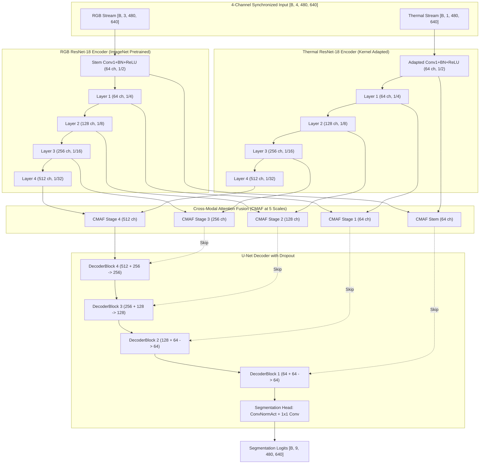

# RGB–Thermal Multi-Spectral Semantic Segmentation

A PyTorch framework for multi-spectral urban scene semantic segmentation combining RGB and Thermal (long-wave infrared) imagery using a **Pretrained Dual-Stream ResNet-18 feature pyramid with Multi-Scale Cross-Modal Attention Fusion (CMAF)**.

[](https://www.python.org/)
[](https://pytorch.org/)
[](https://www.kaggle.com/datasets/danialqashqai/mfnet-dataset)
[](#4-model-architecture)
[](LICENSE)

---

## 1. Overview & Motivation

Semantic segmentation for autonomous driving and mobile robotics relies heavily on 3-channel RGB cameras. However, standard RGB vision degrades drastically in real-world driving environments due to low ambient light, nighttime conditions, direct headlamp glare, dense fog, and heavy shadow occlusions.

Thermal (long-wave infrared / LWIR) sensors measure radiated heat rather than reflected light, preserving distinct object boundaries for pedestrians, cyclists, and running vehicles under total darkness or severe glare. Despite this resilience, thermal imagery lacks fine color and surface texture, making it difficult to distinguish road markings, pavement transitions, and traffic signage.

This project implements a multi-spectral semantic segmentation system that unifies both modalities:
- **RGB Stream (3 channels):** Extracts high-resolution texture, color, and fine geometric features.
- **Thermal Stream (1 channel):** Supplies heat signatures and high-contrast boundaries in low-illumination and night conditions.
- **Cross-Modal Attention Fusion (CMAF):** Dynamically weights and combines feature representations across multiple spatial scales via coupled channel and spatial attention gates.

---

## 2. Key Contributions & Features

- **Pretrained Dual-Stream ResNet-18 Encoders:** Uses parallel ResNet-18 backbones initialized with ImageNet weights. The thermal stream's initial convolution is adapted to a single channel by averaging the pretrained RGB kernels, establishing a balanced initialization.
- **Multi-Scale Cross-Modal Attention Fusion (CMAF):** Operates at all 5 feature pyramid scales (stem, 1/4, 1/8, 1/16, 1/32). Integrates:
  - Squeeze-and-excitation channel attention across concatenated modality channels.
  - Cross-guided spatial attention gates driven by joint mean and max feature projections.
  - Residual connection ($\text{Fused} + 0.5 \times (\text{RGB} + \text{Thermal})$) ensuring raw modality features are never completely suppressed during early training.
- **U-Net Style Decoder with Regularization:** 4-stage decoder using bilinear upsampling, $1\times1$ projections, feature concatenation, `ConvNormAct` blocks (GroupNorm + SiLU), and spatial dropout ($p=0.10$).
- **Differential Optimization:** Differential learning rates via AdamW (0.1× learning rate for pretrained encoders, 1.0× for fusion blocks and decoder).
- **Hybrid Objective Function:** Class-weighted Cross-Entropy loss (supporting `auto`, `mfb`, `enet`, and `none` schemes) combined with multi-class Soft Dice loss, strictly ignoring boundary index 255.
- **Pre-Training Data Audit:** Includes `audit_mfnet.py`, a read-only dataset verification utility that screens for missing file pairs, train/validation split overlap, label integrity, and thermal alpha channel statistics.
- **Resilient Training Workflow:** Supports CUDA Automated Mixed Precision (AMP), gradient clipping, `ReduceLROnPlateau` scheduling, validation-driven early stopping, and atomic checkpointing.

---

## 3. Dataset & Class Definitions

The pipeline is built on the **MFNet (Multi-Spectral Fusion Network)** benchmark dataset:

```
MFNet_dataset/
├── images/       # 4-channel PNG files (channels 0:3 RGB, channel 3 Thermal), 640x480
├── labels/       # Single-channel PNG ground truth masks (pixel values 0-8, 255 ignored)
├── train.txt     # Training split filenames (without extension)
├── val.txt       # Validation split filenames (without extension)
└── test.txt      # Test split filenames (without extension)
```

### Class Mapping (9 Classes)

| Class ID | Class Name | Description | Color Mapping |
|:---:|:---|:---|:---:|
| `0` | **Unlabeled** | Background terrain, sky, unclassified road surroundings | `[0, 0, 0]` |
| `1` | **Car** | Passenger cars, vans, trucks, buses | `[220, 20, 60]` |
| `2` | **Person** | Pedestrians, standing and moving people | `[0, 200, 0]` |
| `3` | **Bike** | Bicycles, motorcycles | `[30, 144, 255]` |
| `4` | **Curve** | Curved lane markers, roadway bends | `[255, 215, 0]` |
| `5` | **Car Stop** | Designated parking and stopping bays | `[255, 20, 147]` |
| `6` | **Guardrail** | Roadside metal/concrete safety barriers | `[0, 255, 255]` |
| `7` | **Color Cone** | Traffic pylons and construction cones | `[255, 140, 0]` |
| `8` | **Bump** | Speed breakers, asphalt road bumps | `[138, 43, 226]` |
| `255` | **Ignore Index** | Boundary transition pixels, void regions | `[128, 128, 128]` |

### Preprocessing & Data Augmentation

- **Input Dimensions:** Native resolution of $480 \times 640$ pixels.
- **In-Model Normalization:**
  - RGB channels: Standard ImageNet mean $\mu = [0.485, 0.456, 0.406]$ and std $\sigma = [0.229, 0.224, 0.225]$.
  - Thermal channel: Normalized to zero-mean, $[-2, 2]$ range ($\mu = [0.5]$, $\sigma = [0.25]$).
- **Synchronized Geometric Augmentation:** Random horizontal flipping ($p=0.5$) and random scaling/cropping applied identically across RGB, thermal, and mask tensors.
- **Independent Photometric Augmentation:** RGB color jitter is applied exclusively to channels 0–2. A separate, mild gain/bias adjustment is applied independently to the thermal channel.

---

## 4. Model Architecture

The active architecture (`CustomDualStreamUNet`) is implemented in `my_model.py` (`ARCHITECTURE_ID = "resnet18_dual_stream_cross_modal_attention_v2_1"`):



### Module Breakdown & Parameter Count

Total Trainable Parameters: **29,055,739 (29.06M)**

| Component | Architecture / Mechanism | Parameters | Trainable |
|:---|:---|:---:|:---:|
| **RGB Encoder** | ResNet-18 (`torchvision.models.resnet18`, ImageNet weights) | 11,176,512 | Yes |
| **Thermal Encoder** | ResNet-18 (Conv1 adapted from 3 ch to 1 ch via mean kernel projection) | 11,170,240 | Yes |
| **CMAF (5 Scales)** | Channel Gate (SE-style MLP) + Dual Spatial Gate ($7\times7$ Conv) + Residual | 4,059,186 | Yes |
| **U-Net Decoder** | 4 Blocks: Bilinear Upsample + $1\times1$ Project + Concat + 2x ConvNormAct | 2,612,224 | Yes |
| **Segmentation Head** | ConvNormAct ($3\times3$, 64 ch) + Final $1\times1$ Conv (64 $\rightarrow$ 9 classes) | 37,577 | Yes |
| **Total** | **Pretrained Dual-Stream ResNet-18 U-Net + CMAF** | **29,055,739** | **100%** |

---

## 5. Training Setup & Loss Formulation

### Objective Function
The loss balances pixel-level cross-entropy with global spatial overlap:

$$\mathcal{L}_{\text{total}} = \mathcal{L}_{\text{CE}} + \mathcal{L}_{\text{Dice}}$$

- **Class-Weighted Cross-Entropy ($\mathcal{L}_{\text{CE}}$):** Mitigates the heavy imbalance where background pixels outnumber rare classes by two orders of magnitude:
  - `auto`: Inverse cube-root frequency weighting ($w_c = \frac{1}{\sqrt[3]{N_c}}$).
  - `mfb`: Median frequency balancing.
  - `enet`: Log-smoothed inverse frequency ($w_c = \frac{1}{\ln(1.02 + p_c)}$).
  - `none`: Unweighted cross-entropy.
- **Multi-Class Soft Dice Loss ($\mathcal{L}_{\text{Dice}}$):** Directly maximizes the intersection-over-union of predicted class probability maps against ground truth, ignoring label 255.

### Optimization Strategy
- **Optimizer:** AdamW with weight decay $10^{-4}$.
- **Differential Learning Rates:**
  - Pretrained Encoders: $\eta_{\text{enc}} = 0.1 \times \eta = 3 \times 10^{-5}$
  - CMAF Fusion & Decoder: $\eta_{\text{dec}} = 1.0 \times \eta = 3 \times 10^{-4}$
- **Learning Rate Scheduler:** `ReduceLROnPlateau` reducing learning rate by $0.5\times$ upon validation mIoU stagnation.
- **Regularization:** Gradient clipping at max norm 5.0, spatial dropout ($p=0.10$) in decoder blocks, bottleneck dropout ($p=0.15$), and validation early stopping with patience of 12 epochs.

---

## 6. Installation & Environment Setup

### 1. Clone the Repository
```bash
git clone https://github.com/atulkumar-ds/RGB-Thermal-Semantic-Segmentation.git
cd RGB-Thermal-Semantic-Segmentation
```

### 2. Virtual Environment Setup
```bash
python -m venv .venv

# On Windows (PowerShell):
.\.venv\Scripts\Activate.ps1

# On Linux / macOS:
source .venv/bin/activate
```

### 3. Install Dependencies
Install PyTorch with CUDA support matching your system's driver:
```bash
# Example for CUDA 12.8 / 12.6 wheels:
pip install torch torchvision --index-url https://download.pytorch.org/whl/cu128

# Install remaining dependencies:
pip install -r requirements.txt
```

Verify GPU setup:
```bash
python -c "import torch, torchvision; print('PyTorch:', torch.__version__, '| CUDA:', torch.cuda.is_available(), '| Device:', torch.cuda.get_device_name(0) if torch.cuda.is_available() else 'CPU')"
```

---

## 7. Dataset Preparation & Audit

### Step 1: Download the MFNet Dataset
Download the MFNet dataset from [Kaggle](https://www.kaggle.com/datasets/danialqashqai/mfnet-dataset) or using the download script:
```bash
python download_dataset.py --dest-dir ../MFNet_dataset
```

Expected folder layout:
```
MFNet_dataset/
├── images/       # 4-channel RGBA images (channels 0:3 RGB, channel 3 Thermal)
├── labels/       # 1-channel ground truth mask PNGs
├── train.txt
├── val.txt
└── test.txt
```

### Step 2: Audit the Dataset Integrity
Run the built-in read-only audit script to verify data integrity before launching training:
```bash
python audit_mfnet.py --data-root ../MFNet_dataset --image-check-limit 0
```
This utility verifies:
- Zero data leakage between training and validation splits.
- Exact $480 \times 640$ resolution pairing between images and masks.
- Absence of corrupted files or non-RGBA formats.
- Correct label distribution across all 9 target classes.

---

## 8. Usage & Execution Commands

### Quick Integration Smoke Test (1 Epoch)
Verify the complete end-to-end forward/backward pipeline, AMP scaling, and prediction logging:
```bash
python train.py --epochs 1 --batch-size 4 --num-workers 4 --log-every 20 --vis-every 1
```

### Full Training Run
Execute the main training loop with automatic mixed precision, early stopping, and periodic visualization:
```bash
python train.py --epochs 60 --batch-size 4 --num-workers 4 --patience 12 --vis-every 5 --log-every 20
```
*(If GPU memory is constrained, set `--batch-size 2`).*

### Resume Training from Checkpoint
Resume training seamlessly from a saved checkpoint:
```bash
python train.py --epochs 60 --resume checkpoints/resnet18_crossmodal_attention_v2_1/last_checkpoint.pt
```

### Command-Line Arguments Reference

| Argument | Type | Default | Description |
|:---|:---:|:---:|:---|
| `--epochs` | `int` | `60` | Total training epochs |
| `--batch-size` | `int` | `4` | Batch size per GPU step |
| `--lr` | `float` | `3e-4` | Base learning rate for fusion/decoder (encoders use $0.1\times$) |
| `--data-root` | `str` | `../MFNet_dataset` | Path to MFNet dataset root |
| `--resume` | `str` | `None` | Path to `last_checkpoint.pt` to resume training |
| `--checkpoint-dir` | `str` | `checkpoints/resnet18_crossmodal_attention_v2_1` | Output directory for checkpoints |
| `--plot-dir` | `str` | `plots/resnet18_crossmodal_attention_v2_1` | Output directory for plots and JSON history |
| `--num-workers` | `int` | `4` | Number of DataLoader worker threads |
| `--patience` | `int` | `12` | Early stopping patience on validation mIoU |
| `--class-weights` | `str` | `auto` | Cross-Entropy weighting (`auto`, `mfb`, `enet`, `none`) |
| `--no-amp` | `flag` | `False` | Disable CUDA automated mixed precision |
| `--no-pretrained` | `flag` | `False` | Train ResNet-18 encoders from scratch without ImageNet weights |

---

## 9. Evaluation & Verified Results

### Baseline Experiment Analysis (v1 Scratch Model)
Before transitioning to pretrained ResNet-18 encoders, an initial custom dual-stream ConvNet (2.99M parameters, trained from scratch without pretrained weights) was benchmarked on MFNet (`BASELINE_RESULTS.md`):

| Metric | Training (Peak) | Validation (Epoch 34 — Best) | Diagnosis |
|:---|:---:|:---:|:---|
| **Mean IoU (mIoU)** | $\approx 86\%$ (0.86) | **`34.56%`** (0.3456) | Severe generalization plateau |
| **Loss** | $\approx 0.32$ | $> 2.0$ (at epoch 50) | Overfitting due to small dataset size |
| **Key Class IoU** | — | Car: `54.3%`, Person: `60.1%`, Bike: `31.1%` | Small objects under-detected |

### Evolution to v2.1 (Pretrained ResNet-18 + CMAF)
The v2.1 architecture directly resolves these findings through:
1. **Pretrained Feature Representations:** Initializing both streams with ResNet-18 weights prevents overfitting on small datasets ($1,568$ training entries).
2. **Channel-Adapted Thermal Initialization:** Initializing thermal kernels by averaging RGB weights establishes an effective starting point for infrared feature extraction.
3. **Rigorous Augmentation & Regularization:** Explicit synchronized geometric augmentation, independent thermal jitter, and decoder dropout prevent the memorization observed in v1.
4. **Dual Metric Reporting:** Tracks both all-class `mIoU` (including class 0) and `foreground mIoU` (classes 1–8) to provide transparent foreground evaluation.

---

## 10. Checkpoints & Output Artifacts

Artifacts are saved cleanly under versioned directories:

```
checkpoints/resnet18_crossmodal_attention_v2_1/
├── best_checkpoint.pt       # Complete checkpoint from highest validation mIoU epoch
├── last_checkpoint.pt       # Resumable checkpoint updated at every completed epoch
└── model_epoch_NNN.pt       # Compact inference-only model snapshot saved every 10 epochs

plots/resnet18_crossmodal_attention_v2_1/
├── epoch_loss.png           # Training vs validation loss curve
├── epoch_metrics.png        # Evolution of all-class mIoU and pixel accuracy
├── miou_foreground.png      # Evolution of foreground-only mIoU (classes 1-8)
├── per_class_iou.png        # Class-wise IoU bar chart at best epoch
├── learning_rate.png        # Effective learning rate schedule over time
├── epoch_NNN_predictions.png# 4-panel visual plots (RGB, Thermal, Ground Truth, Predicted)
└── training_history.json    # Complete epoch-wise numerical metrics log
```

---

## 11. Project Structure

```
RGB-Thermal-Semantic-Segmentation/
├── checkpoints/              # Checkpoint directory
│   └── resnet18_crossmodal_attention_v2_1/
├── plots/                    # Output plots and visual predictions
│   └── resnet18_crossmodal_attention_v2_1/
├── audit_mfnet.py            # Read-only dataset sanity and leakage audit script
├── AUDIT_REPORT.md           # Engineering audit notes and v1 -> v2.1 diagnosis
├── BASELINE_RESULTS.md       # Quantitative results from the initial baseline run
├── CHANGELOG.md              # Detailed record of model and trainer modifications
├── cmds.md                   # Quick command reference and environment guide
├── dataset.py                # 4-channel dataset loader with synchronized augmentations
├── download_dataset.py       # Kaggle dataset download helper
├── my_model.py               # Pretrained Dual-Stream ResNet-18 + CMAF definition
├── requirements.txt          # Project dependencies
├── train.py                  # End-to-end training, validation, and evaluation pipeline
└── README.md                 # Project documentation
```

---

## 12. Literature Comparison

For research context, published multi-spectral semantic segmentation benchmarks on the MFNet dataset report the following results:

| Architecture | Backbone / Encoders | Published MFNet mIoU | Reference |
|:---|:---|:---:|:---|
| **MFNet (Baseline)** | Custom MiniInception Dual-Stream | `56.8%` | Ha et al. (IROS 2017) |
| **RTFNet** | Dual ResNet-152 | `53.2%` | Sun et al. (RAL 2019) |
| **EAEFNet** | ResNet-18 / Efficient | `58.9%` | Freeform Robotics |
| **CMX** | MiT-B2 / MiT-B4 (Transformer) | `58.2% – 59.7%` | Liu et al. (CVPR 2023) |
| **SpatialSeg** | Swin-B (Transformer) | `64.6%` | Sun et al. (2024) |

*Note: Published literature results use differing dataset pre-filtering, train/validation split protocols, and unlabelled class inclusions. Figures should be compared within standardized evaluation splits.*

---

## 13. Limitations & Future Work

- **Edge Deployment & TensorRT Export:** Benchmark inference latency (FPS) on embedded hardware platforms (such as NVIDIA Jetson Orin) after FP16 quantization.
- **Attention Map Visualization:** Export spatial attention heatmaps to visually demonstrate how thermal features guide the network during nighttime scenes.
- **Transformer-Based Cross-Attention:** Investigate swapping convolution-based attention with cross-attention Transformer blocks (e.g., SegFormer / MiT encoders).

---

## 14. References & Acknowledgements

- **MFNet Benchmark:** Q. Ha, K. Watanabe, T. Karasawa, and Y. Ushiku, *"MFNet: Towards Real-Time Semantic Segmentation for Autonomous Vehicles with Multi-Spectral Scenes,"* 2017 IEEE/RSJ International Conference on Intelligent Robots and Systems (IROS).
- **Dataset Hosting:** Danial Qashqai via Kaggle (`danialqashqai/mfnet-dataset`).
- **ResNet Architecture:** K. He, X. Zhang, S. Ren, and J. Sun, *"Deep Residual Learning for Image Recognition,"* CVPR 2016.
