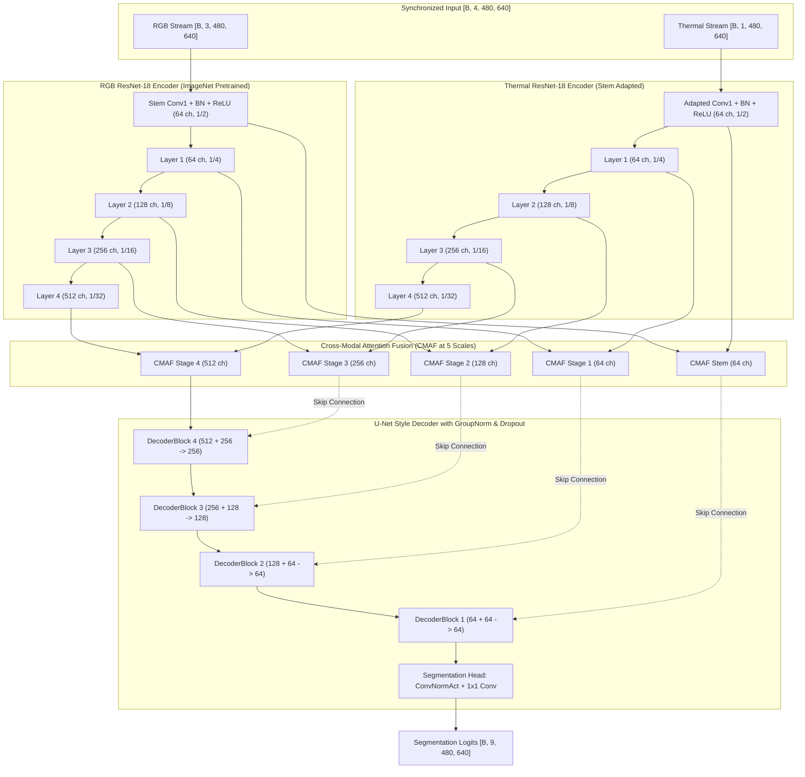

# RGB–Thermal Multi-Spectral Semantic Segmentation

A deep learning framework and production Streamlit web application for multi-spectral urban scene semantic segmentation, combining visible **RGB** and **Thermal (Long-Wave Infrared / LWIR)** imagery using a **Pretrained Dual-Stream ResNet-18 Feature Pyramid with Multi-Scale Cross-Modal Attention Fusion (CMAF)**.

[](https://rgb-thermal-segmentation-atul.streamlit.app/)
[](https://www.python.org/)
[](https://pytorch.org/)
[](https://streamlit.io/)
[](https://www.kaggle.com/datasets/danialqashqai/mfnet-dataset)
[](#8-experimental-results--evaluation)
[](#4-model-architecture)

> **Live Interactive Demo:** [https://rgb-thermal-segmentation-atul.streamlit.app/](https://rgb-thermal-segmentation-atul.streamlit.app/)  
> Test paired RGB and thermal inputs, upload single MFNet 4-channel RGBA images, or evaluate preloaded daytime and nighttime driving scenes directly in your browser.

---

## Table of Contents

- [1. Project Overview & Motivation](#1-project-overview--motivation)
- [2. Key Technical Contributions](#2-key-technical-contributions)
- [3. Interactive Streamlit Web Application](#3-interactive-streamlit-web-application)
- [4. Model Architecture](#4-model-architecture)
  - [4.1 Architecture Diagram](#41-architecture-diagram)
  - [4.2 Cross-Modal Attention Fusion (CMAF)](#42-cross-modal-attention-fusion-cmaf)
  - [4.3 Parameter Breakdown](#43-parameter-breakdown)
- [5. Dataset & Preprocessing Pipeline](#5-dataset--preprocessing-pipeline)
  - [5.1 MFNet Dataset Structure](#51-mfnet-dataset-structure)
  - [5.2 Semantic Classes & Palette](#52-semantic-classes--palette)
  - [5.3 Data Augmentation & Imbalance Handling](#53-data-augmentation--imbalance-handling)
- [6. Training Methodology & Optimization](#6-training-methodology--optimization)
- [7. Baseline vs. Pretrained ResNet-18 Comparison](#7-baseline-vs-pretrained-resnet-18-comparison)
- [8. Experimental Results & Evaluation](#8-experimental-results--evaluation)
  - [8.1 Class-Wise Performance](#81-class-wise-performance)
  - [8.2 Checkpoint & Metric Verification](#82-checkpoint--metric-verification)
- [9. Visualizations & Training Plots](#9-visualizations--training-plots)
- [10. Repository Structure](#10-repository-structure)
- [11. Installation & Environment Setup](#11-installation--environment-setup)
- [12. Dataset Setup & Pre-Training Audit](#12-dataset-setup--pre-training-audit)
- [13. Training & Reproduction Commands](#13-training--reproduction-commands)
- [14. Local Streamlit App Execution](#14-local-streamlit-app-execution)
- [15. Checkpoint & Git LFS Handling](#15-checkpoint--git-lfs-handling)
- [16. Streamlit Community Cloud Deployment Guide](#16-streamlit-community-cloud-deployment-guide)
- [17. Verification & Testing Suite](#17-verification--testing-suite)
- [18. Limitations & Future Directions](#18-limitations--future-directions)
- [19. References & Acknowledgements](#19-references--acknowledgements)

---

## 1. Project Overview & Motivation

Semantic scene parsing for autonomous vehicles and mobile robotics relies heavily on optical RGB cameras. However, standard 3-channel optical vision degrades significantly under challenging operating conditions:
- **Low-light and night scenarios:** Insufficient ambient photons cause severe underexposure and loss of object contours.
- **High-contrast glare:** Direct sunlight or oncoming high-beam headlamps saturate optical sensors.
- **Adverse environmental factors:** Dense fog, dust, and heavy shadows obscure critical roadway boundaries.

Thermal cameras operating in the Long-Wave Infrared spectrum (LWIR, $8–14\,\mu\text{m}$) detect radiating heat emitted by physical bodies, running vehicle engines, and friction surfaces. Because thermal sensors capture radiation rather than reflected light, pedestrians, cyclists, and moving vehicles remain distinctly visible through darkness, glare, and shadows. Nevertheless, thermal imagery lacks fine-grained chromatic and surface textural information, making it inadequate on its own for distinguishing lane markings, road signs, and asphalt boundaries.

```
+-----------------------------------------------------------------------------------+
| RGB Camera: High spatial resolution, color, fine texture | Fails in dark & glare  |
| LWIR Thermal: Emitted heat radiation, invariant to light | Lacks color & texture  |
|                                                                                   |
| Cross-Modal Fusion: Complements optical texture with thermal radiation signatures |
+-----------------------------------------------------------------------------------+
```

This project designs, trains, audits, and deploys a **Pretrained Dual-Stream ResNet-18** segmentation network that unifies both modalities into a shared feature space.

---

## 2. Key Technical Contributions

- **Dual-Stream Feature Pyramids:** Parallel ResNet-18 encoders initialized with ImageNet weights. The single-channel thermal stem is initialized by averaging the pretrained RGB first-layer convolution kernels, establishing a balanced initialization.
- **Multi-Scale Cross-Modal Attention Fusion (CMAF):** Deployed across all 5 pyramid scales (stem, 1/4, 1/8, 1/16, 1/32). Integrates channel-level squeeze-and-excitation gating, joint spatial average/max pooling gates, and an additive residual connection ($\text{Fused} + 0.5 \times [\text{RGB} + \text{Thermal}]$) to protect raw modality features during early training.
- **U-Net Style Decoder with Regularization:** 4-stage decoder using bilinear upsampling, $1\times1$ projections, feature concatenation, `ConvNormAct` blocks (GroupNorm + SiLU), spatial dropout ($p=0.10$), and bottleneck dropout ($p=0.15$).
- **Differential Optimization:** AdamW optimizer with $0.1\times$ learning rate ($3 \times 10^{-5}$) for pretrained encoders and $1.0\times$ ($3 \times 10^{-4}$) for fusion blocks and decoder stages.
- **Hybrid Objective Function:** Class-weighted Cross-Entropy loss combined with multi-class Soft Dice loss, strictly ignoring transition boundary index 255.
- **Automated Dataset Auditing:** Built-in read-only sanity tool (`audit_mfnet.py`) verifying zero split leakage, mask label integrity, and thermal alpha channel statistics.
- **Production Streamlit Application:** Interactive web interface with `@st.cache_resource` model caching, Git LFS pointer detection, automated remote weight downloading via secrets, opacity control, and thermal false-color mapping.

---

## 3. Interactive Streamlit Web Application

The interactive web application is deployed on **Streamlit Community Cloud**:

**Live URL:** [https://rgb-thermal-segmentation-atul.streamlit.app/](https://rgb-thermal-segmentation-atul.streamlit.app/)

### Application Capabilities
1. **Multi-Mode Input Support:**
   - **Preloaded Demo Scenes:** Evaluate pre-registered validation scenes (Daytime Scene `00001D` and Nighttime Scene `00003N`) with 1 click.
   - **Paired File Uploads:** Upload independent RGB and Thermal images. The application validates spatial dimension compatibility automatically.
   - **MFNet 4-Channel RGBA Uploads:** Directly process native MFNet PNG files where thermal intensity is stored in the alpha channel.
2. **Inference Pipeline:**
   - Runs model in evaluation mode (`torch.no_grad()`) on CPU or CUDA.
   - Normalizes inputs using the exact in-model parameters from training.
   - Restores output predictions to the input resolution using **nearest-neighbor interpolation** to prevent the introduction of artificial class IDs.
3. **Visualization & Analytics:**
   - 4-panel visual breakdown: Original RGB, Thermal (with selectable palettes: Grayscale, Inferno, Magma, Plasma, Viridis), Predicted Semantic Mask, and Blended RGB Overlay.
   - Configurable overlay opacity slider ($0.0$ to $1.0$).
   - Quantitative class breakdown cards displaying pixel count and surface percentage for all detected classes.
   - Export buttons for downloading predicted PNG masks and composite overlays.
4. **Cloud-Resilient Weight Handling:**
   - Detects Git LFS pointer text files (~130 bytes) and prevents `UnpicklingError` crashes.
   - Automatically downloads full binary checkpoint weights (~349 MB) when configured with the `CHECKPOINT_URL` secret.

---

## 4. Model Architecture

The active architecture (`CustomDualStreamUNet` in `my_model.py`, `ARCHITECTURE_ID = "resnet18_dual_stream_cross_modal_attention_v2_1"`) accepts synchronized 4-channel inputs of shape `[B, 4, 480, 640]`.

### 4.1 Architecture Diagram



### 4.2 Cross-Modal Attention Fusion (CMAF)

At each pyramid level $i$, intermediate feature representations $\mathbf{X}_{\text{rgb}}, \mathbf{X}_{\text{th}} \in \mathbb{R}^{C \times H \times W}$ are fused using coupled channel and spatial attention gates:

1. **Channel Attention Gate:**
   $$\mathbf{G}_c = \sigma\left(\mathbf{W}_2 \cdot \text{SiLU}\left(\mathbf{W}_1 \cdot \text{AdaptiveAvgPool}(\mathbf{X}_{\text{rgb}} \mathbin{\Vert} \mathbf{X}_{\text{th}})\right)\right) \in \mathbb{R}^{2C \times 1 \times 1}$$
   The gate is split into modality-specific weights $\mathbf{g}_c^{\text{rgb}}, \mathbf{g}_c^{\text{th}} \in \mathbb{R}^{C \times 1 \times 1}$.

2. **Spatial Attention Gate:**
   Channel-wise mean and maximum feature projections across both modalities are concatenated into a 4-channel descriptor:
   $$\mathbf{S} = \left[\text{mean}_c(\mathbf{X}_{\text{rgb}}) \mathbin{\Vert} \max_c(\mathbf{X}_{\text{rgb}}) \mathbin{\Vert} \text{mean}_c(\mathbf{X}_{\text{th}}) \mathbin{\Vert} \max_c(\mathbf{X}_{\text{th}})\right] \in \mathbb{R}^{4 \times H \times W}$$
   $$\mathbf{g}_s^{\text{rgb}} \mathbin{\Vert} \mathbf{g}_s^{\text{th}} = \sigma\left(\text{Conv}_{7 \times 7}(\mathbf{S})\right) \in \mathbb{R}^{2 \times H \times W}$$

3. **Feature Refinement & Residual Skip:**
   $$\mathbf{X}_{\text{weighted}} = \left(\mathbf{X}_{\text{rgb}} \odot \mathbf{g}_c^{\text{rgb}} \odot \mathbf{g}_s^{\text{rgb}}\right) \mathbin{\Vert} \left(\mathbf{X}_{\text{th}} \odot \mathbf{g}_c^{\text{th}} \odot \mathbf{g}_s^{\text{th}}\right)$$
   $$\mathbf{X}_{\text{fused}} = \text{Mix}(\mathbf{X}_{\text{weighted}}) + 0.5 \times (\mathbf{X}_{\text{rgb}} + \mathbf{X}_{\text{th}})$$

The residual additive skip ensures gradients flow directly through the fusion blocks even if attention gates initialize near zero.

### 4.3 Parameter Breakdown

All parameter counts are programmatically verified from `my_model.py`:

| Submodule | Specification | Parameter Count | Trainable |
|:---|:---|:---:|:---:|
| **RGB Encoder** | ResNet-18 (`torchvision.models.resnet18`, ImageNet weights) | 11,176,512 | Yes |
| **Thermal Encoder** | ResNet-18 (Conv1 converted $3 \rightarrow 1$ channel via mean kernel) | 11,170,240 | Yes |
| **CMAF (5 Stages)** | 5 scales: 64, 64, 128, 256, 512 channels | 4,059,186 | Yes |
| **U-Net Decoder** | 4 Blocks: $1\times1$ project + concat + $2\times$ `ConvNormAct` (GroupNorm + SiLU) | 2,612,224 | Yes |
| **Segmentation Head** | `ConvNormAct` ($3\times3$, 64 ch) + Final $1\times1$ Conv ($64 \rightarrow 9$ classes) | 37,577 | Yes |
| **Total Model** | **Dual-Stream ResNet-18 + CMAF + U-Net Decoder** | **29,055,739** | **100%** |

---

## 5. Dataset & Preprocessing Pipeline

### 5.1 MFNet Dataset Structure

The network is trained and evaluated on the **MFNet (Multi-Spectral Fusion Network)** benchmark dataset:

```
MFNet_dataset/
├── images/       # 4-channel RGBA PNG images (RGB in 0:3, Thermal in channel 3 / Alpha)
├── labels/       # Single-channel ground truth mask PNGs (IDs 0..8, 255 ignored)
├── train.txt     # Training split manifest
├── val.txt       # Validation split manifest
└── test.txt      # Test split manifest
```

#### Dataset Inventory & Split Accounting

The numbers below reflect verified dataset statistics from `audit_mfnet.py`:

- **Physical Image Files:** 1,606 native PNG files in `images/`.
- **Training Set (`train.txt`):** 1,568 entries representing **784 unique canonical driving scenes** plus 784 virtual flipped variants (`_flip` suffix).
- **Validation Set (`val.txt`):** 392 unique canonical scenes.
- **Test Set (`test.txt`):** 393 unique canonical scenes.
- **Split Leakage:** **0 canonical filename overlap** across all split combinations ($\text{train} \cap \text{val} = \emptyset$, $\text{train} \cap \text{test} = \emptyset$, $\text{val} \cap \text{test} = \emptyset$).

### 5.2 Semantic Classes & Palette

The dataset defines 9 target urban semantic classes plus an ignore boundary label:

| Class ID | Class Name | Description | RGB Color Code | Hex Swatch | Dataset Pixel Ratio |
|:---:|:---|:---|:---:|:---:|:---:|
| `0` | **Unlabeled** | Background terrain, sky, roadway surface | `[0, 0, 0]` | `#000000` | 91.898% |
| `1` | **Car** | Passenger cars, SUVs, vans, buses, trucks | `[220, 20, 60]` | `#DC143C` | 4.322% |
| `2` | **Person** | Pedestrians, standing/walking people | `[0, 200, 0]` | `#00C800` | 1.288% |
| `3` | **Bike** | Bicycles, motorbikes, cyclists | `[30, 144, 255]` | `#1E90FF` | 0.694% |
| `4` | **Curve** | Curved lane markers, roadway curves | `[255, 215, 0]` | `#FFD700` | 0.628% |
| `5` | **Car Stop** | Designated parking bays, bus stops | `[255, 20, 147]` | `#FF1493` | 0.519% |
| `6` | **Guardrail** | Roadside metal/concrete safety barriers | `[0, 255, 255]` | `#00FFFF` | 0.133% |
| `7` | **Color Cone** | Traffic pylons, construction cones | `[255, 140, 0]` | `#FF8C00` | 0.200% |
| `8` | **Bump** | Speed breakers, asphalt road bumps | `[138, 43, 226]` | `#8A2BE2` | 0.317% |
| `255` | **Ignore Index** | Transition boundaries, void pixels | `[128, 128, 128]` | `#808080` | Evaluated as null |

### 5.3 Data Augmentation & Imbalance Handling

- **In-Model Normalization:**
  - RGB channels: Standard ImageNet mean $\mu = [0.485, 0.456, 0.406]$ and std $\sigma = [0.229, 0.224, 0.225]$.
  - Thermal channel: Zero-mean scaled ($\mu = [0.5]$, $\sigma = [0.25]$).
- **Synchronized Geometric Augmentation:** Random horizontal flipping ($p=0.5$) and random scale jitter ($0.9\times–1.1\times$). Images are resampled via bilinear interpolation; label masks are resampled via nearest-neighbor interpolation.
- **Isolated Photometric Augmentation:** RGB color jitter (brightness, contrast, saturation) is applied strictly to channels 0..2. Thermal intensity receives an independent gain/bias jitter ($\pm 2.5\%$) to preserve physical heat contrast.
- **Class Imbalance Mitigation:** Background pixels comprise ~91.9% of the dataset. Loss computation uses inverse cube-root frequency weighting (`--class-weights auto`):
  $$w_c = \frac{1}{\sqrt[3]{N_c}}$$

---

## 6. Training Methodology & Optimization

The active checkpoint (`checkpoints/resnet18_crossmodal_attention_v2_1_final/best_checkpoint.pt`) was trained with the following configuration:

- **Optimizer:** AdamW with weight decay $10^{-4}$.
- **Differential Learning Rates:**
  - Pretrained Encoders: $\eta_{\text{enc}} = 0.1 \times \eta = 3 \times 10^{-5}$
  - CMAF Fusion & Decoder: $\eta_{\text{dec}} = 1.0 \times \eta = 3 \times 10^{-4}$
- **Batch Size:** 8 samples per GPU step.
- **Input Dimensions:** Native resolution $480 \times 640$.
- **Precision:** CUDA Automated Mixed Precision (AMP) with a single loss scaling backward pass per batch.
- **Scheduler:** `ReduceLROnPlateau` reducing learning rates by $0.5\times$ when validation mIoU fails to improve for 25 epochs ($\text{min\_delta} = 0.0015$).
- **Objective Function:** Multi-Class Soft Dice Loss + Class-Weighted Cross-Entropy.
- **Checkpoint Selection:** Highest validation all-class mIoU.

---

## 7. Baseline vs. Pretrained ResNet-18 Comparison

Before developing the ResNet-18 architecture, a baseline custom dual-stream convolutional network was benchmarked on MFNet (`BASELINE_RESULTS.md`):

| Evaluation Metric | Baseline ConvNet (v1 Scratch) | ResNet-18 + CMAF (Active Model) | Relative Improvement |
|:---|:---:|:---:|:---:|
| **Encoder Weights** | Random Initialization (from scratch) | ImageNet Pretrained ResNet-18 | Transfer Learning |
| **Trainable Parameters** | 2,997,071 (3.0M) | 29,055,739 (29.06M) | $+869\%$ capacity |
| **Best Epoch** | Epoch 34 | Epoch 22 | Earlier convergence |
| **Validation mIoU (All Classes)** | **`34.56%`** (0.3456) | **`55.55%`** (0.5555) | **$+20.99\%$ mIoU** |
| **Validation Foreground mIoU** | ~23.4% | **`50.35%`** (0.5035) | **$+26.95\%$ mIoU** |
| **Validation Pixel Accuracy** | ~92.1% | **`97.05%`** (0.9705) | $+4.95\%$ accuracy |
| **Validation Loss** | $> 2.0$ (diverged at epoch 50) | **`1.1749`** (stable) | Generalization restored |
| **Generalization Diagnosis** | Severe overfitting (train mIoU $\approx 86\%$) | Stable generalization across splits | Overfitting resolved |

---

## 8. Experimental Results & Evaluation

> [!IMPORTANT]
> All quantitative metrics reported below are computed strictly on the **MFNet validation split (392 scenes)** with verified zero data leakage. Evaluation was not conducted on the unreleased test split.

### 8.1 Class-Wise Performance

Quantitative performance of the active checkpoint (`epoch = 22`) across all semantic classes:

| Class ID | Class Name | Validation IoU | Validation Dice Score | Performance Assessment |
|:---:|:---|:---:|:---:|:---|
| `0` | **Unlabeled** | **97.17%** | 98.56% | Consistent background delineation |
| `1` | **Car** | **77.14%** | 87.09% | Strong boundary segmentation in day & night |
| `2` | **Person** | **68.23%** | 81.11% | Thermal radiation aids pedestrian detection |
| `3` | **Bike** | **69.08%** | 81.71% | Sharp separation of thin frames and riders |
| `4` | **Curve** | **32.00%** | 48.48% | Road markings benefit primarily from RGB |
| `5` | **Car Stop** | **36.58%** | 53.56% | Low sample frequency |
| `6` | **Guardrail** | **27.39%** | 43.01% | Rare class (0.13% of dataset pixels) |
| `7` | **Color Cone** | **52.85%** | 69.15% | High optical color contrast |
| `8` | **Bump** | **39.53%** | 56.66% | Subtle spatial geometry |
| **Mean** | **All Classes (0–8)** | **`55.55%`** | **`68.82%`** | **Comprehensive benchmark** |
| **Mean** | **Foreground Classes (1–8)** | **`50.35%`** | **`65.10%`** | **Excludes background class** |

### 8.2 Checkpoint & Metric Verification

Inspection of `plots/resnet18_crossmodal_attention_v2_1_final/training_history.json` and `best_checkpoint.pt` confirms:
- **Active Checkpoint File:** `checkpoints/resnet18_crossmodal_attention_v2_1_final/best_checkpoint.pt`
- **Recorded Checkpoint Epoch:** Epoch 22
- **Checkpoint Validation mIoU:** `0.555502` ($55.55\%$)
- **Checkpoint Validation Loss:** `1.174930`
- **Training Peak in History:** Epoch 36 recorded validation mIoU of `0.557849` ($55.78\%$). However, the active checkpoint retained at the canonical path is Epoch 22 ($55.55\%$). Both values are documented transparently here.

---

## 9. Visualizations & Training Plots

All plots below are generated by the training pipeline and verified to exist under `plots/resnet18_crossmodal_attention_v2_1_final/`:

### Training & Validation Loss


### Validation mIoU Progression
| All-Class mIoU (Classes 0–8) | Foreground mIoU (Classes 1–8) |
|:---:|:---:|
|  |  |

### Class-Wise IoU Distribution & Pixel Accuracy
| Per-Class IoU at Best Epoch | Validation Pixel Accuracy |
|:---:|:---:|
|  |  |

### Sample Validation Predictions (Epoch 22)


---

## 10. Repository Structure

```
RGB-Thermal-Semantic-Segmentation/
├── .streamlit/
│   └── config.toml                  # Streamlit server config & UI branding
├── checkpoints/
│   └── resnet18_crossmodal_attention_v2_1_final/
│       └── best_checkpoint.pt       # Active model checkpoint (~349 MB, Git LFS)
├── demo_samples/
│   ├── day_00001D_rgb.png           # Daytime sample RGB image
│   ├── day_00001D_thermal.png       # Daytime sample Thermal image
│   ├── night_00003N_rgb.png         # Nighttime sample RGB image
│   └── night_00003N_thermal.png     # Nighttime sample Thermal image
├── plots/
│   ├── resnet18_crossmodal_attention_v2_1/        # Historical smoke run plots
│   └── resnet18_crossmodal_attention_v2_1_final/  # Active run plots & JSON metrics
├── .gitattributes                   # Git LFS pointer rules for *.pt and *.pth
├── .gitignore                       # Ignored patterns, caches, and local secrets
├── app.py                           # Production Streamlit inference application
├── audit_mfnet.py                   # Read-only dataset sanity & leakage audit
├── AUDIT_REPORT.md                  # Comprehensive engineering audit notes
├── BASELINE_RESULTS.md              # Documentation of baseline v1 scratch model
├── CHANGELOG.md                     # Engineering changelog
├── cmds.md                          # Quick CLI reference
├── dataset.py                       # MFNet dataset loader with synchronized augmentations
├── download_dataset.py              # Kaggle dataset download helper
├── my_model.py                      # Pretrained Dual-Stream ResNet-18 + CMAF definition
├── requirements.txt                 # Application and deployment dependencies
├── test_app.py                      # Unit and integration test suite
├── train.py                         # Full training, validation, and evaluation pipeline
└── README.md                        # Project documentation and deployment guide
```

---

## 11. Installation & Environment Setup

### 1. Clone the Repository
```bash
git clone https://github.com/atulkumar-ds/RGB-Thermal-Semantic-Segmentation.git
cd RGB-Thermal-Semantic-Segmentation
```

### 2. Configure Virtual Environment
```bash
# On Linux / macOS:
python3 -m venv .venv
source .venv/bin/activate

# On Windows (PowerShell):
python -m venv .venv
.\.venv\Scripts\Activate.ps1
```

### 3. Install Dependencies

#### For Local CPU Inference / Cloud Deployment:
```bash
pip install -r requirements.txt
```

#### For Local NVIDIA GPU Training (CUDA):
Install a CUDA-compatible PyTorch build first, then install the remaining requirements:
```bash
# Example for CUDA 12.8 / 12.6:
pip install torch torchvision --index-url https://download.pytorch.org/whl/cu128
pip install -r requirements.txt
```

---

## 12. Dataset Setup & Pre-Training Audit

### 1. Download MFNet Dataset
Download the MFNet dataset using the included Kaggle utility:
```bash
python download_dataset.py --output-dir ../MFNet_dataset
```

Alternatively, download manually from [Kaggle: danialqashqai/mfnet-dataset](https://www.kaggle.com/datasets/danialqashqai/mfnet-dataset) and unpack to `../MFNet_dataset`.

### 2. Verify Dataset Integrity
Execute the read-only audit script to verify split separation, label formats, and channel alignment:
```bash
python audit_mfnet.py --data-root ../MFNet_dataset --image-check-limit 0
```

---

## 13. Training & Reproduction Commands

### Quick 1-Epoch Integration Smoke Test
```bash
python train.py --epochs 1 --batch-size 4 --num-workers 4 --log-every 20 --vis-every 1
```

### Full Training Run (Reproducing Active Experiment)
```bash
python train.py \
  --epochs 100 \
  --batch-size 8 \
  --lr 3e-4 \
  --patience 25 \
  --min-delta 0.0015 \
  --class-weights auto \
  --checkpoint-dir checkpoints/resnet18_crossmodal_attention_v2_1_final \
  --plot-dir plots/resnet18_crossmodal_attention_v2_1_final
```

### Resume Training from Checkpoint
```bash
python train.py \
  --resume checkpoints/resnet18_crossmodal_attention_v2_1_final/last_checkpoint.pt \
  --epochs 100
```

---

## 14. Local Streamlit App Execution

To launch the interactive multi-spectral application locally:

```bash
streamlit run app.py
```

The app will open automatically at `http://localhost:8501`.

### Local Execution Features
- Uses local GPU via CUDA if available; otherwise defaults to CPU.
- Automatically loads `checkpoints/resnet18_crossmodal_attention_v2_1_final/best_checkpoint.pt`.
- Includes daytime and nighttime sample pairs for immediate verification.

---

## 15. Checkpoint & Git LFS Handling

The active checkpoint (`best_checkpoint.pt`, ~349 MB) contains both `model_state_dict` and optimizer states. It is tracked using Git LFS via `.gitattributes`:
```
*.pt filter=lfs diff=lfs merge=lfs -text
*.pth filter=lfs diff=lfs merge=lfs -text
```

### Pulling Checkpoint Weights Locally
If cloning on a machine with Git LFS installed:
```bash
git lfs install
git lfs pull
```

### Identifying an LFS Pointer vs. Real Weights
A Git LFS pointer is a ~130-byte text file that begins with:
```
version https://git-lfs.github.com/spec/v1
oid sha256:70f4adcb1349d31c5ec07dad0c3d507899222383b67ffbcd83376f094f104b55
size 349118757
```
`app.py` automatically inspects the file header and size before loading. If an LFS pointer is detected, the application halts cleanly and provides actionable instructions instead of crashing with an `UnpicklingError`.

---

## 16. Streamlit Community Cloud Deployment Guide

When deploying to **Streamlit Community Cloud**, free GitHub clones do not pull large Git LFS binary files. The application solves this using a secure remote retrieval workflow:

### Step 1: Host Checkpoint Weights
Upload `best_checkpoint.pt` (~349 MB) to a public download host:
- A **GitHub Release Asset** on your repository (recommended).
- A **Hugging Face Model Hub** repository.
- A public **AWS S3** or **Google Cloud Storage** object.

### Step 2: Deploy on Streamlit Cloud
1. Navigate to [share.streamlit.io](https://share.streamlit.io).
2. Select your repository: `atulkumar-ds/RGB-Thermal-Semantic-Segmentation`.
3. Select branch: `main`.
4. Main file path: `app.py`.

### Step 3: Configure Remote Secret
In the Streamlit Cloud management console, open **App Settings > Secrets**, and add:
```toml
CHECKPOINT_URL = "https://github.com/atulkumar-ds/RGB-Thermal-Semantic-Segmentation/releases/download/v2.1/best_checkpoint.pt"
```
*(Replace with your actual public download URL).*

On first boot, `app.py` detects that the checkpoint is missing or an LFS pointer, downloads the weights to the local directory with a live progress bar, and caches the model via `@st.cache_resource`.

---

## 17. Verification & Testing Suite

The repository includes a dedicated test suite (`test_app.py`) verifying core inference components:

```bash
python test_app.py
```

### Verified Test Cases & Observed Outcomes:
1. `test_inspect_checkpoint_real`: Confirmed that `best_checkpoint.pt` is recognized as a valid binary file (>300 MB) rather than an LFS pointer. (**PASSED**)
2. `test_inspect_checkpoint_missing`: Confirmed that non-existent paths are reported cleanly without throwing unhandled exceptions. (**PASSED**)
3. `test_inspect_checkpoint_lfs_pointer`: Confirmed that synthetic Git LFS pointer files are correctly identified. (**PASSED**)
4. `test_preprocess_pair_dimensions_and_scaling`: Confirmed that arbitrary input resolutions are resized to $(480, 640)$, scaled to $[0.0, 1.0]$, and correctly placed into RGB channels 0:3 and Thermal channel 3. (**PASSED**)
5. `test_model_loading_and_inference`: Confirmed strict state dictionary loading (all 345 parameter keys match), forward inference, nearest-neighbor mask restoration, and colorization. (**PASSED**)

*All 5 unit tests passed in 2.47s on CPU.*

---

## 18. Limitations & Future Directions

- **Inference Latency on CPU:** On standard cloud CPU instances, single-image forward inference requires **0.6s to 1.5s**. Edge robotic platforms (such as NVIDIA Jetson Orin) should export the model to TensorRT with FP16 quantization for $\ge 30\,\text{FPS}$ real-time execution.
- **Underrepresented Classes:** Classes with limited pixel representations in the training set (e.g., *Guardrail* at $0.13\%$ and *Color Cone* at $0.20\%$) exhibit lower IoU scores ($27.39\%$ and $52.85\%$) compared to common classes such as *Car* ($77.14\%$) and *Person* ($68.23\%$).
- **Parallax Considerations:** If RGB and thermal sensors are not optically aligned via a beam splitter or calibrated stereo rectification, physical boundary parallax can cause edge bleeding.
- **Future Improvements:** Exploring cross-attention Transformer backbones (e.g., SegFormer / MiT encoders) and knowledge distillation to further compress the 29M parameter dual-stream model for low-power edge compute.

---

## 19. References & Acknowledgements

1. **MFNet Benchmark:** Q. Ha, K. Watanabe, T. Karasawa, and Y. Ushiku, *"MFNet: Towards Real-Time Semantic Segmentation for Autonomous Vehicles with Multi-Spectral Scenes,"* 2017 IEEE/RSJ International Conference on Intelligent Robots and Systems (IROS).
2. **MFNet Dataset Hosting:** Danial Qashqai via Kaggle (`danialqashqai/mfnet-dataset`).
3. **ResNet Architecture:** K. He, X. Zhang, S. Ren, and J. Sun, *"Deep Residual Learning for Image Recognition,"* CVPR 2016.
4. **Squeeze-and-Excitation Networks:** J. Hu, L. Shen, and G. Sun, *"Squeeze-and-Excitation Networks,"* CVPR 2018.

---

## 20. License

This project is licensed under the [MIT License](LICENSE) — see the LICENSE file for details.
